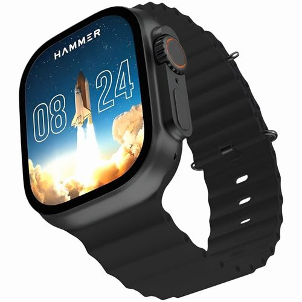
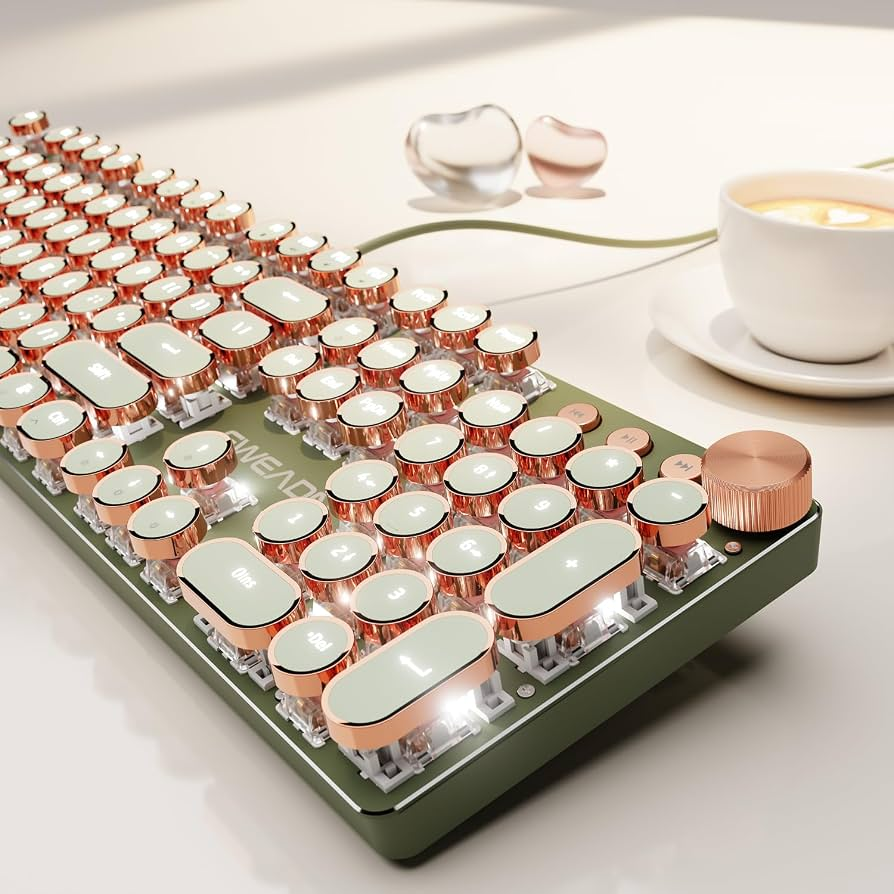
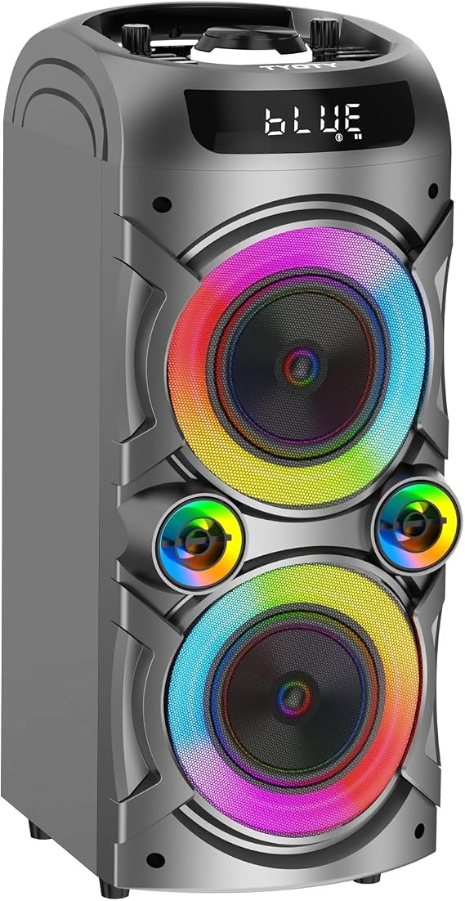
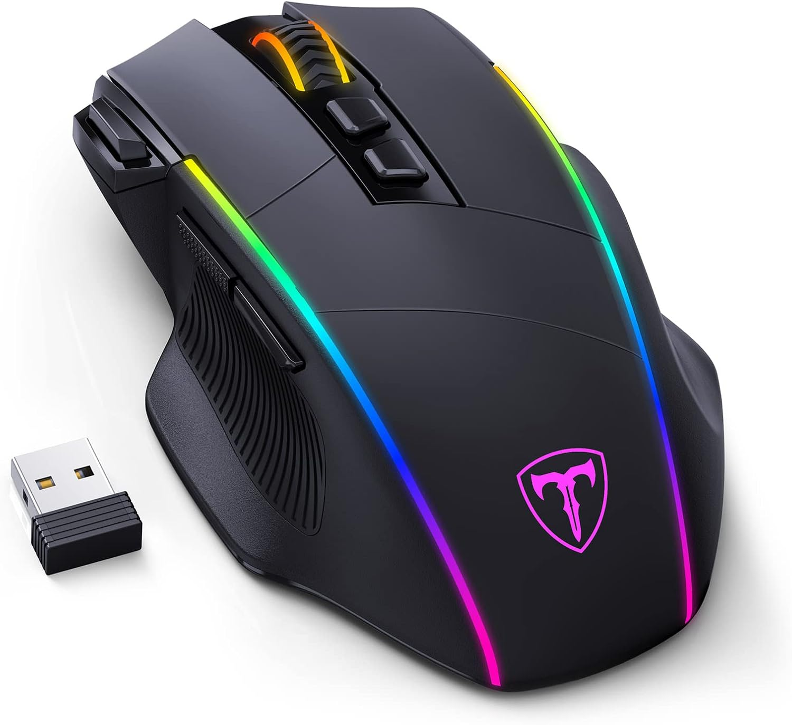
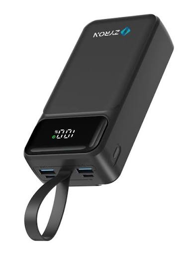
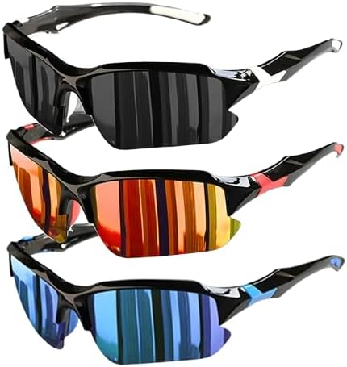
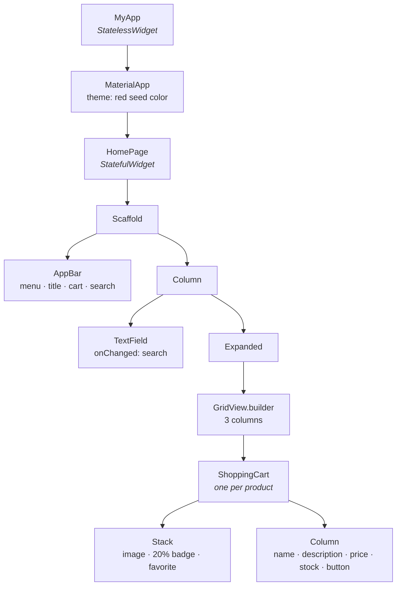

<div align="center">

# 🛒 Shopping App — Section 3

### Flutter for Mobile Development

Build a product catalog with a **live search bar**, a **responsive grid**, and **reusable product cards**.


</div>

---

## 📖 Table of Contents

- [About This Section](#-about-this-section)
- [What You Will Learn](#-what-you-will-learn)
- [The Products](#-the-products)
- [Project Structure](#-project-structure)
- [Widget Tree](#-widget-tree)
- [Code Walkthrough](#-code-walkthrough)
- [From Column to ListView to GridView](#-from-column-to-listview-to-gridview)
- [Getting Started](#-getting-started)
- [Practice Challenges](#-practice-challenges)
- [Useful Resources](#-useful-resources)

---

## 🎯 About This Section

In this section we build a small **shopping app** that shows a list of products as cards.
Each card shows a picture, a discount badge, a favorite button, the product's name, description, price, stock, and an **Add to Cart** button.

At the top of the screen there is a **search field**. As you type, the grid updates instantly to show only the matching products. This is your first real look at **state** in Flutter.

---

## 🧠 What You Will Learn

| # | Concept | Where to find it |
|:-:|---------|------------------|
| 1 | Creating a **model class** with `final` fields and a `const` constructor | `lib/product.dart` |
| 2 | Storing data in a `List<Product>` | `lib/product.dart` |
| 3 | Splitting the UI into **reusable widgets** that take parameters | `lib/shopping_cart.dart` |
| 4 | `StatelessWidget` vs `StatefulWidget` | `shopping_cart.dart` vs `home_page.dart` |
| 5 | Updating the screen with `setState()` | `lib/home_page.dart` |
| 6 | Reading user input with `TextField` and `onChanged` | `lib/home_page.dart` |
| 7 | Filtering a list with `.where()` and `.toList()` | `lib/home_page.dart` |
| 8 | Building lists efficiently with `ListView.builder` and `GridView.builder` | `lib/home_page.dart` |
| 9 | Layering widgets with `Stack` and `Positioned` | `lib/shopping_cart.dart` |
| 10 | Styling with `BoxDecoration` (shadow, rounded corners, clipping) | `lib/shopping_cart.dart` |
| 11 | Loading local images with `Image.asset` and `pubspec.yaml` | `Images/`, `pubspec.yaml` |
| 12 | App-wide colors with `ThemeData` and `ColorScheme.fromSeed` | `lib/main.dart` |

---

## 🧾 The Products

The app ships with 8 sample products, stored in the `Images/` folder:

<table>
  <tr>
    <td align="center"><br/><b>Wireless Earbuds</b><br/>$129.99</td>
    <td align="center"><br/><b>Smart Watch</b><br/>$149.50</td>
    <td align="center"><br/><b>Mechanical Keyboard</b><br/>$59.00</td>
    <td align="center"><br/><b>Laptop Backpack</b><br/>$39.99</td>
  </tr>
  <tr>
    <td align="center"><br/><b>Bluetooth Speaker</b><br/>$45.25</td>
    <td align="center"><br/><b>Gaming Mouse</b><br/>$29.90</td>
    <td align="center"><br/><b>Portable Charger</b><br/>$34.99</td>
    <td align="center"><br/><b>Sports Sunglasses</b><br/>$24.50</td>
  </tr>
</table>

---

## 📁 Project Structure

```
shopping_app_2/
├── Images/                  🖼️  Product pictures (registered in pubspec.yaml)
├── lib/
│   ├── main.dart            🚀  App entry point, MaterialApp and theme
│   ├── home_page.dart       🏠  Home screen: search field + product grid (Stateful)
│   ├── shopping_cart.dart   🃏  One product card widget (Stateless)
│   └── product.dart         📦  Product model + sample products list
├── test/
│   └── widget_test.dart     🧪  Default widget test
└── pubspec.yaml             ⚙️  Dependencies and assets
```

---

## 🌳 Widget Tree



---

## 🔍 Code Walkthrough

### 1️⃣ `main.dart` — Starting the app

`runApp()` starts the app. `MaterialApp` sets the title and theme, and shows `HomePage` as the first screen.

```dart
return MaterialApp(
  title: "ShoppingApp",
  theme: ThemeData(
    colorScheme: ColorScheme.fromSeed(seedColor: Colors.red),
  ),
  debugShowCheckedModeBanner: false,
  home: const HomePage(),
);
```

> 💡 `ColorScheme.fromSeed` generates a whole color palette from **one** color. Try changing `Colors.red` to `Colors.teal` and see the whole app change.

### 2️⃣ `product.dart` — The data model

A `Product` class describes **what a product is**. All fields are `final`, so a product can't change after it's created.

```dart
class Product {
  final String name;
  final String description;
  final double price;
  final String image;
  final int amount;

  const Product({
    required this.name,
    required this.description,
    required this.price,
    required this.image,
    required this.amount,
  });
}
```

Then we create a `List<Product>` called `products` that holds all our sample data.

### 3️⃣ `shopping_cart.dart` — A reusable card

`ShoppingCart` is a `StatelessWidget` that receives **one** `Product` and draws a card for it. We write the card once and reuse it for every product.

```dart
class ShoppingCart extends StatelessWidget {
  final Product product;

  ShoppingCart({required this.product});
  ...
}
```

Key ideas inside the card:

- **`Stack` + `Positioned`** place the `20%` badge (top-left) and the ❤️ button (top-right) **on top of** the image.
- **`BoxDecoration`** gives the card rounded corners (`borderRadius`) and a shadow (`boxShadow`).
- **`clipBehavior: Clip.antiAlias`** cuts the image so it follows the rounded corners.
- **String interpolation** shows values inside text: `Text("\$${product.price}")`.

### 4️⃣ `home_page.dart` — State and search

`HomePage` is a `StatefulWidget` because the screen **changes** when the user types.

```dart
String query = '';

void search(String value) {
  setState(() {
    query = value;
  });
}
```

Each time `setState` runs, Flutter calls `build()` again, and we filter the list:

```dart
List<Product> filtered_products = products.where((n) {
  return n.name.contains(query);
}).toList();
```

The `TextField` calls `search` every time the text changes:

```dart
TextField(
  onChanged: search,
)
```

🔁 **The cycle:** type a letter → `onChanged` → `search()` → `setState()` → `build()` → new filtered list → grid redraws.

---

## 🔄 From Column to ListView to GridView

`home_page.dart` keeps the **older versions** of the layout as comments, so you can see how the code evolved during the lecture. Uncomment each one to try it.

| Step | Approach | Problem / Benefit |
|:---:|----------|-------------------|
| **1** | `SingleChildScrollView` + `Column` with cards written by hand | ❌ You must write `products[0]`, `products[1]`, ... yourself. Doesn't scale. |
| **2** | `ListView.builder` | ✅ Builds cards automatically from `itemCount`, and only builds what is visible on screen. |
| **3** | `GridView.builder` | ✅ Same benefits, but shows products in **3 columns**. This is the current version. |

```dart
GridView.builder(
  gridDelegate: SliverGridDelegateWithFixedCrossAxisCount(
    crossAxisCount: 3,
    childAspectRatio: 1.4,
  ),
  itemCount: filtered_products.length,
  itemBuilder: (BuildContext context, int index) {
    return ShoppingCart(product: filtered_products[index]);
  },
)
```

> ⚠️ `GridView` is wrapped in **`Expanded`** because it lives inside a `Column`. Without it, the grid tries to be infinitely tall and Flutter throws an error. Try removing `Expanded` to see the error yourself!

---

## 🚀 Getting Started

### Prerequisites

- [Flutter SDK](https://docs.flutter.dev/get-started/install) (Dart SDK `^3.13.1`)
- An editor: **Android Studio** or **VS Code** with the Flutter extension
- An emulator, a real device, or Chrome / Windows desktop

### Run the project

```bash
# 1. Clone the repository
git clone <repository-url>
cd shopping_app_2

# 2. Get the packages
flutter pub get

# 3. Check that everything is set up
flutter doctor

# 4. Run the app
flutter run
```

> 💡 The grid uses 3 columns, so it looks best on a **wide screen**. Try `flutter run -d chrome` or `flutter run -d windows`.

### Adding your own images

1. Put the image file inside the `Images/` folder.
2. The whole folder is already registered in `pubspec.yaml`:
   ```yaml
   flutter:
     assets:
       - Images/
   ```
3. Add a new `Product` to the list in `product.dart` using `image: 'Images/your_image.jpg'`.
4. Do a **full restart** (not hot reload) so Flutter picks up the new asset.

---

## 🏋️ Practice Challenges

Try these on your own to practice what you learned. They go from easy ⭐ to harder ⭐⭐⭐.

- [ ] ⭐ **Add a product** — add a 9th product with your own image.
- [ ] ⭐ **Change the theme** — pick a different seed color and change the card's shadow color to match.
- [ ] ⭐ **Better search field** — give the `TextField` a hint (`"Search products..."`) and a search icon using `InputDecoration`.
- [ ] ⭐⭐ **Case-insensitive search** — right now searching `"watch"` won't find `"Smart Watch"`. Fix it with `.toLowerCase()`.
- [ ] ⭐⭐ **Search the description too** — match products whose name **or** description contains the query.
- [ ] ⭐⭐ **No results message** — show a `Text("No products found")` when the filtered list is empty.
- [ ] ⭐⭐ **Real discount** — add a `discount` field to `Product` and show it in the badge instead of the fixed `20%`.
- [ ] ⭐⭐⭐ **Favorite button** — make the ❤️ toggle between `favorite_border` and `favorite` when tapped (hint: the card needs state).
- [ ] ⭐⭐⭐ **Responsive grid** — use `MediaQuery.of(context).size.width` to show 1 column on phones and 3 on wide screens.
- [ ] ⭐⭐⭐ **Fix the test** — `test/widget_test.dart` is still the default counter test. Rewrite it to check that `"Shopping App"` appears on screen.

---

## 📚 Useful Resources

- 📘 [Flutter Documentation](https://docs.flutter.dev/)
- 🧩 [Widget Catalog](https://docs.flutter.dev/ui/widgets)
- 🔁 [Stateful vs Stateless Widgets](https://docs.flutter.dev/ui/interactivity)
- 📜 [Working with Long Lists](https://docs.flutter.dev/cookbook/lists/long-lists)
- 🔲 [Creating a Grid List](https://docs.flutter.dev/cookbook/lists/grid-lists)
- 🖼️ [Adding Assets and Images](https://docs.flutter.dev/ui/assets/assets-and-images)
- 🎯 [Dart Language Tour](https://dart.dev/language)

---

<div align="center">

*Flutter for Mobile Development · Section 3*

</div>
